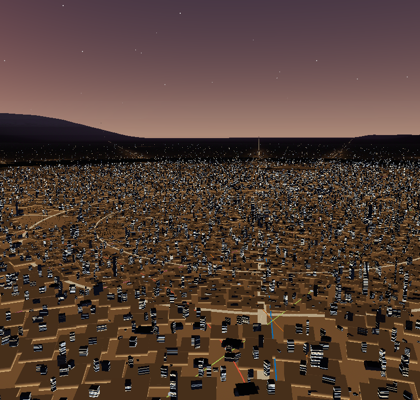
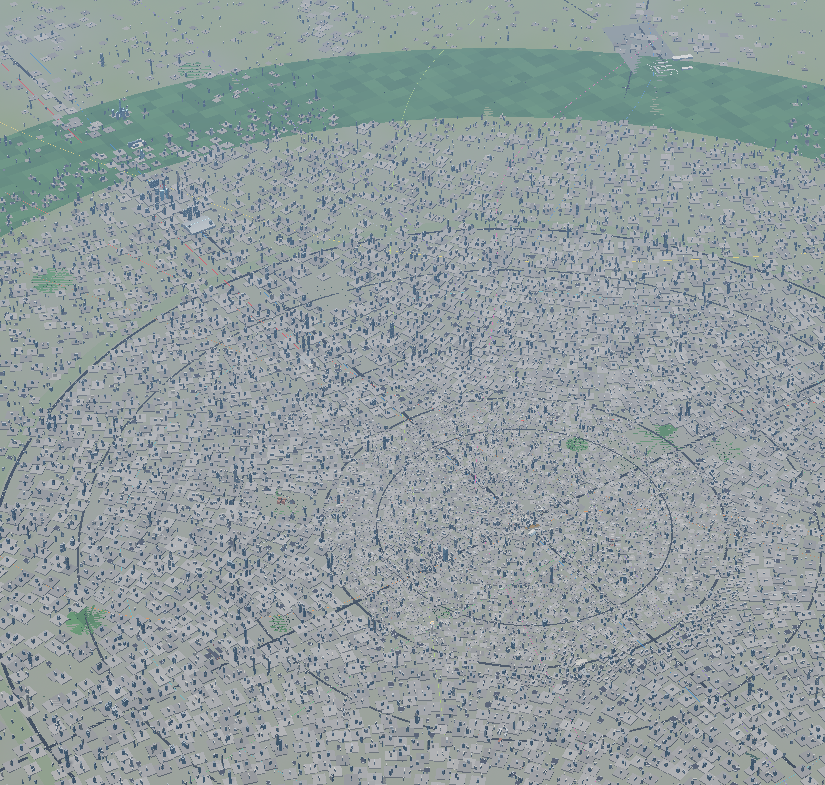
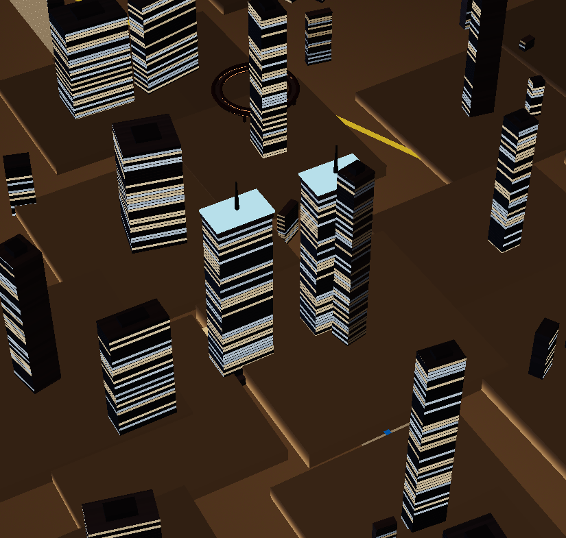

# 成都 3D 城市沙盘 · Chengdu 3D Sandbox

纯前端、零外部请求的成都市三维数字沙盘。整座城市——地形、雪山、环状放射路网、三万余栋建筑、地标、水系、轨道网、昼夜与天气——全部由代码在浏览器里程序化生成，不加载任何模型、贴图或地理数据文件。

坐标原点落在**天府广场**（30.6577°N，104.0657°E），北向为 −Z，**1 个场景单位 = 100 米**，垂直方向 1:1 不夸张。所以这张沙盘是可量化的：绕城高速半径 13.5 km 就是 135 个单位，成都绿地中心 468 就是 468 米。

> **在线体验**：https://xxlchaoren.github.io/chengdu-3d-sandbox/

| 夜景全景（蓝调时刻 20:12） | 日间沙盘视角 | 地标飞入：天府双塔 |
|---|---|---|
|  |  |  |

## 快速开始

```bash
npm install
npm run dev          # → http://127.0.0.1:4420
```

```bash
npm run build        # tsc --noEmit + vite build
npm run preview      # 预览生产构建 → http://127.0.0.1:4421
npm test             # 22 项自动化测试
npm run perf         # 离线统计建筑格覆盖率、生成耗时、几何量
```

要求：Node **≥ 23.6**（推荐 24）——`npm test` 与 `npm run perf` 直接跑 `.ts`，依赖 Node 原生类型剥离且无需 flag；支持 WebGL2 的浏览器。

## 为什么一眼就是成都

不是靠贴图，而是靠把成都的**空间结构**写进生成规则：

- **环 + 放射的极坐标格网**。8 条环线（内环 2.26 km → 第二绕城 35.5 km）与 17 条放射干道构成骨架，建筑沿格网采样，越靠近环路越密——这是成都"摊大饼"的几何本质，也是它和上海方格网、北京正南正北棋盘最根本的区别。
- **真实的地理边界**。西侧龙门山抬升 4400 m、北侧龙泉山脉 3000 m、东侧龙泉山 850 m，成都平原被三面山地把控；晴夜西方天际线出现雪山轮廓。西北—东南走向的府南河（府河＋南溪合流）、摸底河、沙河等 10 条河流与 11 处湖泊（青龙湖、锦城湖、升仙湖……）按方位落位。
- **环城生态公园绿环**。半径 12.1–14.9 km 的环带（对应绕城高速两侧绿道，实际一级绿道 100 km、串 121 个生态公园）在沙盘上是一条连续的低密度绿带，把"公园城市"读得出来。
- **手工建模的地标**。天府双塔（含连桥幕墙）、绿地中心 468、蜀峰 460、西博城、环球中心、成都东站、大魔方、339 天府熊猫塔、宽窄巷子、武侯祠、杜甫草堂、金沙、交子金融环等 47 处 POI，各有方位与建成年份。
- **北京时间要减 1.062 小时**。成都实际太阳时比东经 120° 基准晚约 64 分钟，所以日落常在北京时间 20:00 前后。天空与光照模型内置了这个经度修正，黄昏才会出现在它该在的位置。

## 交互

| 操作 | 效果 |
|---|---|
| 拖拽 / 滚轮 / 右键 | 环绕、缩放（5–950 单位）、平移 |
| `1` / `2` / `3` | 沙盘 / 全景 / 地图三种视角（各自相机参数见 `src/core/renderer.ts`） |
| `r` | 复位视角 |
| `n` / `d` | 切到深夜（21:36）/ 正午（12:24） |
| `空格` | 暂停或推进昼夜循环 |
| `h` | 隐藏/显示控制台 |
| 点击建筑或地标 | 拾取并弹出信息卡 |
| 左侧「地标」列表 | 相机平滑飞入（支持双塔、468、339、东站等） |
| 左侧图层开关 | 地形 / 绿地 / 水系 / 路网 / 车流 / 建筑 / 地标 / 轨道 / 标注 9 层独立显隐 |
| 时间按钮 | 清晨 06:36、正午 13:06、黄昏 19:54、深夜 22:36 |
| 天气 | 晴 / 雾 / 雨 / 雪（影响雾密度、窗光与粒子层） |
| 环线分区 | 高亮「一环内·老城 → 绕城以外」六个 band 之一 |

视角、图层、时刻、天气写入 `localStorage`（键 `cd-sandbox-state-v1`），刷新后保留。

## 渲染要点

- Three.js r180 + `InstancedMesh`。整城约 **760 次 draw call、230 万三角面**，中端 GPU 稳定 60 fps。
- 后处理链：`EffectComposer` → `UnrealBloomPass` → `OutputPass`，ACES Filmic 色调映射、曝光 1.06、sRGB 输出。Bloom 只作用于自发光，因此夜景的灯光是"亮出来的"而不是"提亮的"。
- 材质统一走 `MeshStandardMaterial.onBeforeCompile` 注入 GLSL，并用 `customProgramCacheKey` 区分程序缓存；所有动态量（`uNight`、`uMist`、`uRain`、`uBandSel`、`uLitGain`……）挂在 `src/core/uniforms.ts` 的全局 uniform 总线上，一次更新、全场响应。
- 夜景的光是分层做的：屋顶近黑、沿街墙脚受路灯洒亮、窗光按 `litRatio` 随机点亮、道路走廊与轨道线自发发光、地形按 `urbanity²` 铺开光污染薄毯。远看是一条条街道在发光，而不是一片黄斑。
- 首帧预算 < 5 s，实测约 1.3–1.5 s。

## 工程结构

```
src/
  geo/      chengdu.ts（城市数据）· project.ts（坐标/极坐标）· pois.ts（47 处地标）· rng.ts（可复现哈希）
  city/     terrain green water roads traffic buildings landmarks metro（各图层生成器）
            field.ts place.ts paths.ts ribbon.ts matkit.ts（共用底座）
  core/     renderer.ts（相机/视角/飞入/拾取/后处理）· sky.ts（太阳、天空、雾、天气）· uniforms.ts
  ui/       panel.ts（控制台）
  state.ts  main.ts  style.css
tests/      geo · mesh · offline · shader
scripts/    perf.ts · capture-helper.js（开发期截图回读）
docs/       PROMPT.md（生成提示词）· REFERENCES.md（调研来源）· DATA.md（数据与近似策略）
```

## 已知近似

这是**沙盘**，不是数字孪生。以下取舍是刻意的，理由见 [docs/DATA.md](docs/DATA.md)：

- 无真实建筑矢量轮廓：建筑由环状放射格网 + 密度场生成，总量、高度分布与天际线形态准确，单体位置不对应真实楼栋。
- 近景街区仍是示意性的（一块地 1–3 个体量 + 院落），远中景（本沙盘的主体视角）已用街坊附属体量补齐。
- 路网只建模到环线、放射干道与主干格网，不铺支路；轨道按线路走向与站点数近似。
- 地形高程按龙门山—龙泉山的实测幅度线性套壳，平原微起伏 ±15 m，无 DEM。
- 无阴影贴图（改由法线与 AO 近似），以换取千级实例下的帧率。

## 测试

`npm test` 覆盖四类断言：地理投影与环带分区正确性、几何实例数量与内存边界、**离线可运行性**（源码内不得出现任何外部 URL/CDN/字体引用）、GLSL 保留字扫描（ANGLE 会静默拒绝整段片元着色器，导致图层消失，只留一条 console 报错）。

## 部署

已发布到 GitHub Pages：https://xxlchaoren.github.io/chengdu-3d-sandbox/

`base: './'` 让产物能直接跑在项目页子路径下，无需改路径前缀。站点内容放在孤儿分支 `gh-pages`（只有 `index.html` + `assets/` + `.nojekyll`），由本地 `npm run build` 后推送；`.github/workflows/deploy.yml` 是等价的 CI 版本（`npm ci → npm test → npm run build → upload-pages-artifact`），构建前置跑测试，因此线上版本不可能带着回归发布。

重新发布：

```bash
npm run build
# 用 dist/ 内容重建 gh-pages 分支并推送，然后在 Pages 设置里触发一次 build
```

## 许可

MIT，见 [LICENSE](LICENSE)。
